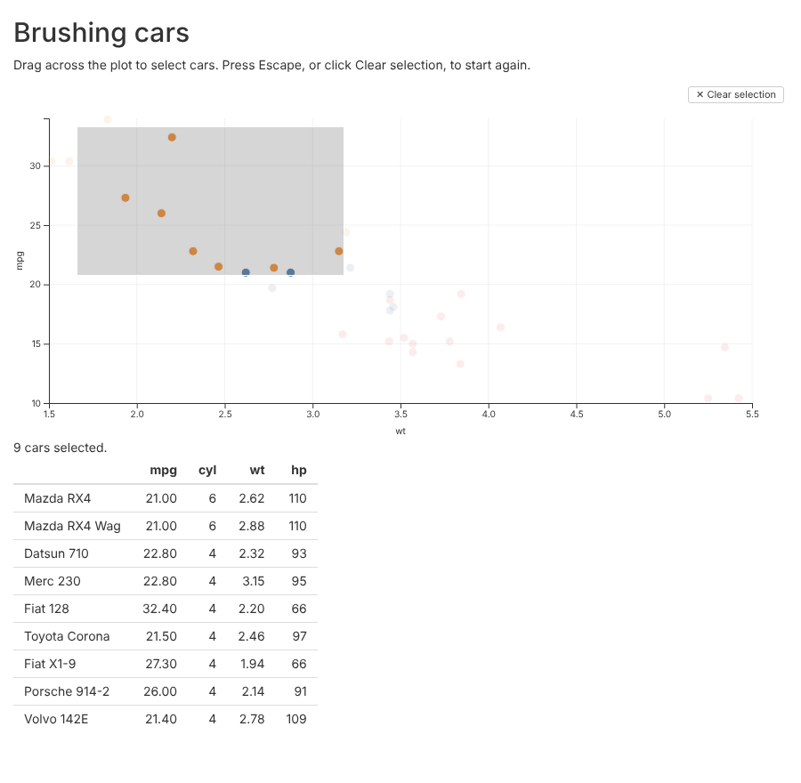

```{r, include = FALSE}
knitr::opts_chunk$set(
  collapse = TRUE,
  comment = "#>"
)
```

glyph plots work in Shiny apps. `glyphOutput()` puts a plot in the page and
`renderGlyph()` draws it from the server. When the user brushes points,
clicks a mark or clicks a legend entry, the server gets the row numbers of
what they selected.

This article is built around a small app that comes with glyph. You brush
points in a scatterplot of `mtcars`, and a table lists the cars you
selected. Run it with:

```{r, eval = FALSE}
shiny::runApp(system.file("examples", "shiny-brush", package = "glyph"))
```

```{r, echo = FALSE, out.width = "100%", fig.alt = "The example app: a scatterplot of car weight against miles per gallon, with a grey brush rectangle over nine light, efficient cars. Below it, the text '9 cars selected.' and a table of those nine cars."}

```

shiny is not installed with glyph. Install it with
`install.packages("shiny")` before you try this.

## The app

This is the whole app:

```{r, eval = FALSE, code = readLines(system.file("examples", "shiny-brush", "app.R", package = "glyph"))}
```

The rest of this section goes through it.

### Placing the plot

`glyphOutput("plot", height = "400px")` reserves space for the plot in the
page. The width is 100% by default. The plot is drawn to fit the space it
is given.

### Drawing the plot

`renderGlyph()` takes the same pipeline you would print at the console:

```{r, eval = FALSE}
output$plot <- renderGlyph(
  glyph(cars, x = wt, y = mpg) |>
    mark_point(color = factor(cyl)) |>
    interact(brush = TRUE, tooltip = TRUE)
)
```

It also takes a layout from `compose()`, or a widget from `render()`. If
the expression returns `NULL`, the output is left empty.

The plot needs something the user can select with. Here that is
`interact(brush = TRUE)`. Without it, `input$plot_selected` never changes.

### Reading the selection

The selection arrives as `input$plot_selected`: the output's name followed
by `_selected`. It holds the row numbers of the data frame given to
`glyph()`, so `cars[input$plot_selected, ]` gives the selected rows. When
nothing is selected it is `NULL`. The table uses `req()` to show nothing
until there is a selection.

In a Shiny module, use `glyphOutput(ns("plot"))` in the module's UI, and
the selection arrives in the module server as `input$plot_selected`.

## When the server hears about it

The value changes when the user does one of these:

- Ends a brush. The value is sent when the mouse button is released, not
  while the brush is dragged. A brush that takes in no points sends
  `integer(0)`.
- Clicks a mark in a plot with `interact(click = "select")`. The mark's
  rows are selected. Clicking it again clears the selection.
- Clicks an entry in a legend added with `selection(type = "legend")`.
  Clicking an entry hides its rows, and the rows still shown are the
  selection. With every entry shown again, the value is `NULL`.
- Clears a brush, with the "Clear selection" button, the Escape key, or a
  click on an empty part of the plot. The value becomes `NULL`.

Each new selection replaces the last one.

A redraw also clears the selection, and sends `NULL`. The plot is redrawn
when `renderGlyph()` runs again, for example because a reactive value it
uses has changed. It is also redrawn when its output changes size, for
example when the browser window is resized.

So keep `input$plot_selected` out of the plot's own `renderGlyph()`. A plot
that depends on its own selection is redrawn each time the user selects
something, and the selection is lost straight away. Use the selection in
other outputs, as the example does with its table.

## What the row numbers count

The numbers are positions in the data frame, like those from `which()`.
They are not row names.

They count every row of the data frame, including rows that aren't drawn.
A mark leaves out rows with a missing x or y value, and warns that it did.
Those rows are never selected, but the rows after them keep their numbers.
A computed mapping such as `x = log(wt)` doesn't change the numbers either.

```{r, eval = FALSE}
df <- data.frame(x = c(1, NA, 3, 4), y = c(2, 5, 1, 3))
glyph(df, x = x, y = y) |> mark_point() |> interact(brush = TRUE)
# Brushing every point gives c(1L, 3L, 4L).
```

Selecting a box, violin, histogram bin or polygon selects every row it
summarises. A sina mark draws a point for each row, so each point is one
row.

A mark that has its own `data`, such as
`mark_line(data = trend, x = x, y = fit)`, draws rows of another data
frame. It adds nothing to the value.

## Facets and layouts

A `facet()` grid splits one data frame into panels, so its value is one
vector. Each panel has its own brush, and the value holds the rows
selected in any of them.

A `compose()` layout can show different data in each panel. Its value is a
list with one entry per panel, in the order the panels were given. If
`compose()` was called with names, the entries have those names:

```{r, eval = FALSE}
output$plots <- renderGlyph(
  compose(
    cars = glyph(mtcars, x = wt, y = mpg) |>
      mark_point() |>
      interact(brush = TRUE),
    flowers = glyph(iris, x = Sepal.Length, y = Petal.Length) |>
      mark_point() |>
      interact(brush = TRUE)
  )
)
```

Here `input$plots_selected` is `NULL` until something is selected. After
the user brushes a few cars it is, for example,
`list(cars = c(3L, 18L, 20L), flowers = NULL)`. Each entry holds row
numbers of that panel's data, so `mtcars[input$plots_selected$cars, ]`
gives the cars. A panel with no selection is `NULL`. When every panel is
back to `NULL`, so is the whole value. A layout nested inside another
gives a nested list of the same shape.

With `linked_selections = TRUE`, a selection in one panel highlights the
matching rows in the others. Only the selection itself is reported. A
panel that only highlights another panel's selection reports `NULL`.

## Limits

Some things are not done yet:

- Selections only go from the browser to the server. The server can't set
  or clear a selection.
- Only selections are sent. Zooming, hovering and tooltips stay in the
  browser.
- A redraw clears the selection, as described above, including a redraw
  caused by resizing.
- In a plot without a brush there is no "Clear selection" button, and
  Escape does nothing. To clear a click selection, click the selected mark
  again.
- A legend matches a row to its entry by looking through the row's values
  for one that is also a colour level. If another column holds a value
  that is also a colour level, the row can be matched to the wrong entry.
